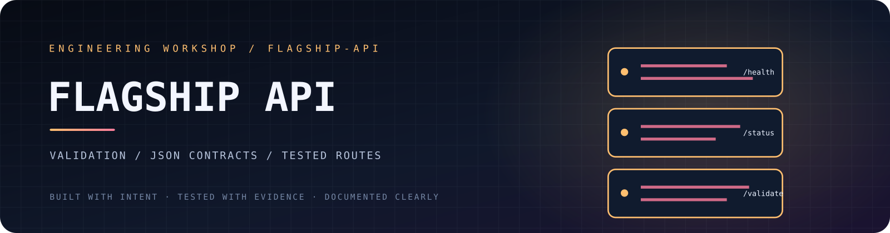
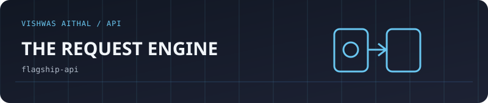
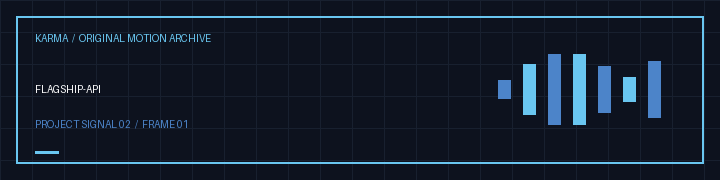

<p align="center"></p>

<p align="center">
  <a href="https://github.com/vishwasaithalz/flagship-api/actions/workflows/tests.yml"></a>
  
  
  
</p>

<p align="center"><strong>A small Node.js API foundation focused on clear contracts and predictable behaviour.</strong></p>

<p align="center"><a href="#-endpoints">Endpoints</a> · <a href="#-run-locally">Run locally</a> · <a href="#-tests">Tests</a> · <a href="#-security-boundaries">Security</a></p>

## 🚢 What it includes

- Node.js built-in HTTP server with no runtime dependencies.
- Health and service-status endpoints.
- JSON validation endpoint with explicit field limits.
- Consistent JSON error responses and status codes.
- Request body size limit.
- Basic security response headers.
- Integration tests using Node's built-in test runner.

## 🧭 Endpoints

| Method | Route | Purpose |
|---|---|---|
| GET | `/health` | Liveness check |
| GET | `/api/v1/status` | Service metadata |\n| GET | `/openapi.json` | Machine-readable OpenAPI 3.1 contract |
| POST | `/api/v1/validate` | Validate a small JSON payload |

The validation route accepts an object with a required `name` string (1 to 80 characters) and an optional `role` string (up to 80 characters).

## ⚡ Run locally

**Requirements:** Node.js 20 or newer and npm.

```powershell
git clone https://github.com/vishwasaithalz/flagship-api.git
cd flagship-api
npm install
npm start
```

The API listens on [http://localhost:3000](http://localhost:3000) by default. Set `PORT` to use another port.

Try the health route:

```powershell
Invoke-RestMethod http://localhost:3000/health
```

Try validation:

```powershell
$body = @{ name = "Demo User"; role = "learner" } | ConvertTo-Json
Invoke-RestMethod -Method Post -Uri http://localhost:3000/api/v1/validate -ContentType "application/json" -Body $body
```

## 🧪 Tests

```powershell
npm test
```

## 🔐 Security boundaries

This is a learning API, not a production-ready internet service. It currently has no authentication, database, CORS policy, or external integrations. Keep it in a trusted development environment.

Before production use, define a threat model and add authentication, authorisation, rate limiting, deployment-specific TLS, monitoring, and operational safeguards. Never commit secrets or real user data.

## 🗺️ Roadmap

- [ ] Add schema-driven request validation.
- [ ] Improve request logging with sensitive-field redaction.
- [ ] Add API contract documentation.
- [ ] Add rate limiting and configurable CORS only with explicit requirements.
- [ ] Add a deployment adapter after the core API is hardened.

## 🤝 Contributing

Keep changes small and test endpoint success, invalid input, malformed JSON, and oversized bodies. See [CONTRIBUTING.md](CONTRIBUTING.md) and [SECURITY.md](SECURITY.md).

<p align="center"><sub>Clear contracts. Small surface area. Predictable errors.</sub></p>


<!-- KARMA VISUAL IDENTITY: START -->
<div align="center">

**API ENGINEERING / RELIABILITY**

 

<sub>Designed for clarity. Built for evidence. No invented status metrics.</sub>

</div>
<!-- KARMA VISUAL IDENTITY: END -->


<!-- KARMA ANIMATED SIGNAL -->
<p align="center"></p>
<details><summary><strong>🎛 Explore the interactive Vishwas Aithal universe</strong></summary><p><a href="https://karma-ops-monitor.vercel.app">Launch the music-enabled Vishwas Aithal homepage</a>. Sound is user-controlled. Motion can be reduced.</p></details>


<!-- KARMA AVATAR GALLERY -->
<p align="center"></p>
<p align="center"><a href="https://karma-ops-monitor.vercel.app/#gallery">Explore the animated project gallery</a></p>


### Original motion gallery



[Download this project's GIF](assets/karma-motion.gif) · [View the animated SVG](assets/karma-signal.svg)
